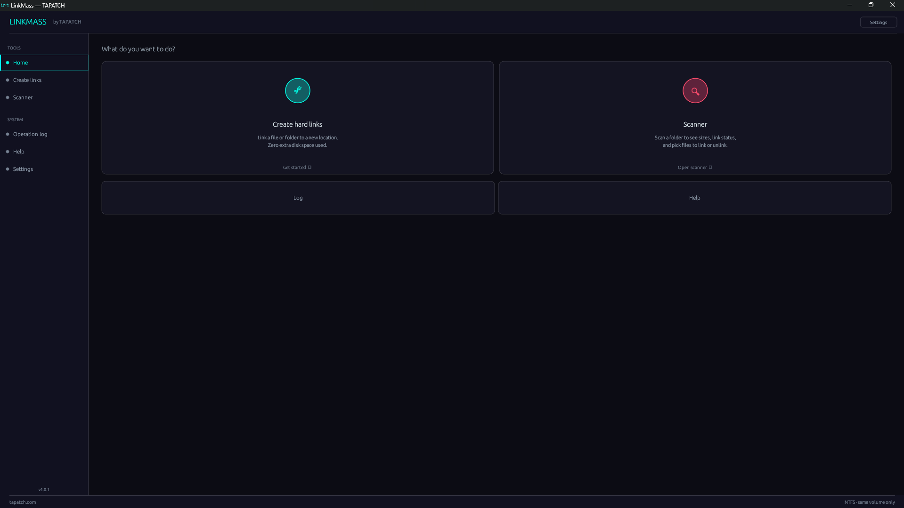

**LinkMass 1.0.4** for Windows 10/11 (x64) · Free for personal use

### What's new

- Now runs on any Windows 10 or 11 PC, even a fresh install: it no longer needs the Microsoft Visual C++ Redistributable (no more "VCRUNTIME140.dll was not found")
- Nothing else changed

### Screenshots

### Video

### Download

**`LinkMass-Setup-1.0.4.exe`** is attached below. It is the same file as on [tapatch.com/tools/linkmass](https://tapatch.com/tools/linkmass/).

### Security

- VirusTotal: **0 / 70** engines flag it · [view report](https://www.virustotal.com/gui/file/5deeacaf4e47552093b6ea2b48f2f8a9d8269972d4bec19f1feb94f58e5ff2fa/detection)
- SHA-256: `5deeacaf4e47552093b6ea2b48f2f8a9d8269972d4bec19f1feb94f58e5ff2fa`

*First released on tapatch.com on 2026-10-17.*

---
Free for personal use. Business or commercial use requires a paid license (see [tapatch.com/terms](https://tapatch.com/terms/)).
