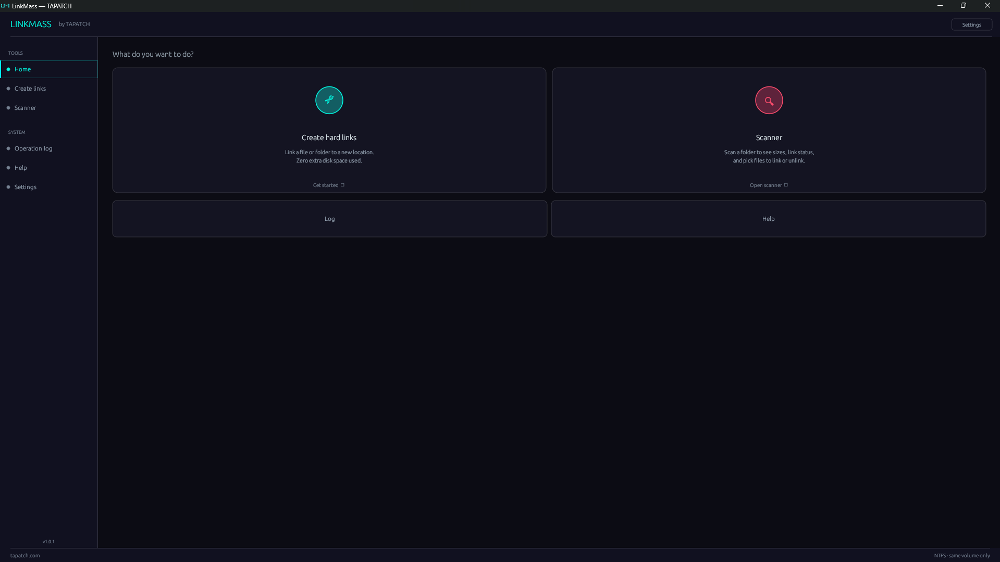

**LinkMass 1.0.5** for Windows 10/11 (x64) · Free for personal use

### What's new

- Background pictures and GIFs: add as many as you like in Settings, tick the ones to show (or Select all), and the ticked ones take turns
- Sliders set how strong the picture is and how see-through the panels are; turn it off any time
- "Overwrite if file already exists" makes the new link first and only then replaces the old file, so a failed link can't lose a file; files already linked are left alone
- Unlink never leaves a file missing, and the scanner skips files that changed since the scan
- Linking into a folder inside the source is refused with a clear message, and folder shortcuts are skipped, so it can't loop forever
- The review step no longer freezes on big folders, and the Small / Medium / Large start-up sizes stick
- Settings are saved safely (a crash mid-save can't wipe them), and it no longer redraws while idle
- The installer's license text matches the current Terms, and THIRD-PARTY-NOTICES.txt lists the open-source parts it uses

### Screenshots

### Download

**`LinkMass-Setup-1.0.5.exe`** is attached below. It is the same file as on [tapatch.com/tools/linkmass](https://tapatch.com/tools/linkmass/).

### Security

- VirusTotal: **1 / 71** engines flag it · [view report](https://www.virustotal.com/gui/file/a803ae4d9cbc90771939550aef099aca526220e9c3306a9a23046215684b6fca/detection)
- SHA-256: `a803ae4d9cbc90771939550aef099aca526220e9c3306a9a23046215684b6fca`

*First released on tapatch.com on 2026-11-05.*

---
Free for personal use. Business or commercial use requires a paid license (see [tapatch.com/terms](https://tapatch.com/terms/)).
