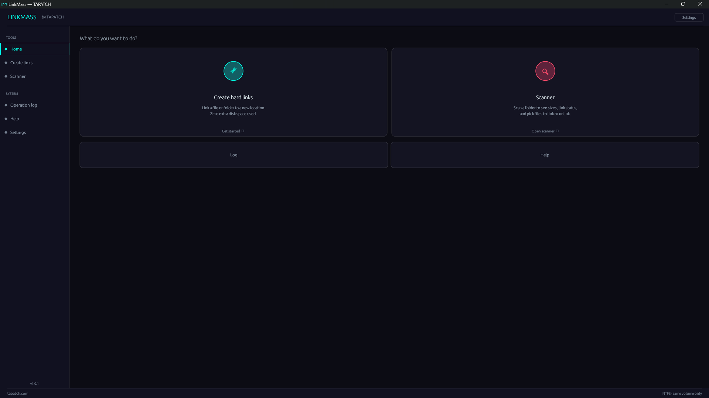

**LinkMass 1.0.6** for Windows 10/11 (x64) · Free for personal use

### What's new

- Arrows, check marks and other symbols no longer show as empty boxes

### Screenshots

### Download

**`LinkMass-Setup-1.0.6.exe`** is attached below. It is the same file as on [tapatch.com/tools/linkmass](https://tapatch.com/tools/linkmass/).

### Security

- VirusTotal: **1 / 70** engines flag it · [view report](https://www.virustotal.com/gui/file/023bd4755c5ec0296074fb3e5ab6adf5ef7f6ba9ea9edae028ce5c230d0f00ff/detection)
- SHA-256: `023bd4755c5ec0296074fb3e5ab6adf5ef7f6ba9ea9edae028ce5c230d0f00ff`

*First released on tapatch.com on 2026-11-07.*

---
Free for personal use. Business or commercial use requires a paid license (see [tapatch.com/terms](https://tapatch.com/terms/)).
